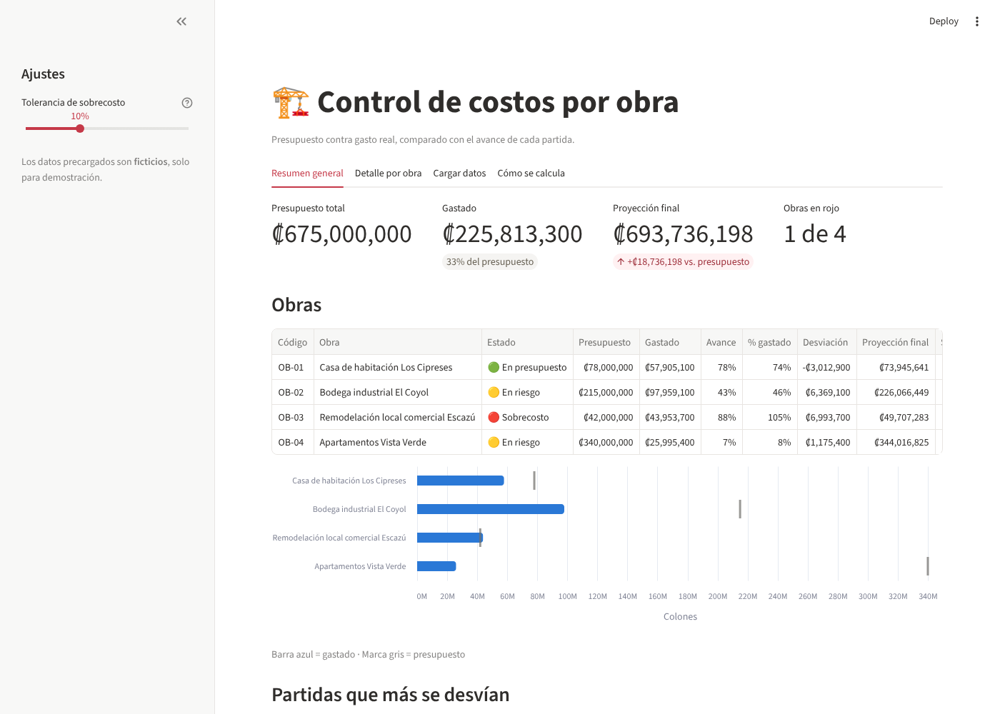
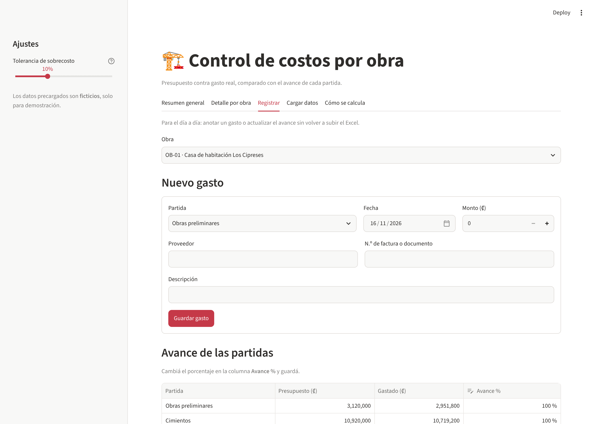

# 🏗️ Control de costos por obra


Herramienta web para constructoras pequeñas que compara el **presupuesto** contra el
**gasto real** de cada obra, partida por partida, y avisa cuáles se están pasando.



## El problema

En muchas constructoras pequeñas el control se lleva en Excel, con un archivo por obra.
Cuando un ingeniero maneja varias obras a la vez, cuesta responder rápido la pregunta
importante: **¿el gasto va de acuerdo con el presupuesto?**

Mirar solo "cuánto queda" engaña: una partida que gastó el 60 % de su plata con un 40 %
de avance va mal aunque tenga saldo. Esta herramienta compara cada partida contra su
avance y proyecta cuánto costará al terminar.

## Qué hace

- **Resumen general**: todas las obras en una pantalla, con semáforo (🟢 🟡 🔴),
  desviación y proyección del costo final.
- **Detalle por obra**: partidas, gasto acumulado por mes, proveedores con más gasto y
  lista de gastos.
- **Carga desde Excel**: se descarga una plantilla, se llena y se sube. Si el archivo
  trae errores, dice en qué hoja y en qué fila están, y no carga nada a medias.
- **Registro del día a día**: formulario para anotar un gasto, tabla para corregir o
  borrar gastos y tabla para actualizar el avance de las partidas, sin volver a subir el Excel.
- **Salidas a Excel**: reporte de una obra (resumen, partidas y gastos) y respaldo completo
  de los datos, que se puede volver a cargar.
- **Resumen de alertas**: un script arma un mensaje corto con las obras que van mal, listo
  para WhatsApp o correo, y se puede programar para que corra solo.
- **Gastos sin presupuestar**: si aparece un gasto en una partida que no estaba en el
  presupuesto, lo carga con presupuesto 0 y lo marca en rojo.



## Estado del proyecto

Siendo honesto sobre lo que hay y lo que falta:

- ✅ Funciona de punta a punta con datos de ejemplo y tiene pruebas automáticas.
- ⚠️ **Los datos incluidos son ficticios** (obras, clientes, proveedores y montos inventados).
- ⏳ **Todavía no se ha probado con datos reales de una constructora.** Es el siguiente paso.
- ⏳ No tiene usuarios ni contraseñas, ni historial de quién cambió qué.
- ⏳ No está publicada en internet; por ahora corre en la computadora de quien la usa
  (ver `docs/PUBLICAR.md`).

## Cómo correrlo

```bash
pip install -r requirements.txt
streamlit run streamlit_app.py
```

Se abre en `http://localhost:8501`. La primera vez arranca con los datos de ejemplo.

Para correr las pruebas:

```bash
pytest
```

## Cómo está hecho

| Parte | Tecnología | Para qué |
|---|---|---|
| Base de datos | SQLite | Guarda obras, partidas y gastos en un solo archivo |
| Consultas | SQL (`JOIN`, `GROUP BY`, CTE, funciones de ventana) | Junta y suma los datos |
| Cálculos | pandas | Desviación, proyección y semáforo |
| Importación | pandas + openpyxl | Lee y valida el Excel |
| Interfaz | Streamlit + Altair | Tablas y gráficos |
| Pruebas | pytest | Revisa los cálculos y la importación |

```
streamlit_app.py      Interfaz: solo dibuja la pantalla
costos/
  esquema.sql         Definición de las 3 tablas
  db.py               Conexión y ejecución de consultas
  calculos.py         Indicadores (pandas)
  importar.py         Excel -> validación -> base de datos
  registro.py         Registrar, corregir y borrar gastos; actualizar avances
  exportar.py         Reporte por obra y respaldo en Excel
  alertas.py          Resumen de alertas en texto
  powerbi.py          Exportación en CSV para Power BI
  demo.py             Generador de datos ficticios
sql/                  Una consulta por archivo, comentada
tests/                Pruebas automáticas
docs/GUIA.md          Explicación del código, paso a paso
docs/PUBLICAR.md      Cómo publicarla y qué limitaciones tiene
docs/PARA_LA_CONSTRUCTORA.md  Cómo probarla con datos de una obra real
docs/AUTOMATIZAR.md   Programar el resumen de alertas con cron
practica/             Ejercicios de SQL y pandas sobre esta misma base, con revisor
powerbi/              Datos en CSV y guía para armar el tablero en Power BI (DAX)
```

### Indicadores

| Indicador | Fórmula |
|---|---|
| Costo esperado | presupuesto × avance |
| Desviación | gastado − costo esperado |
| Proyección final | gastado ÷ avance |
| Sobrecosto proyectado | proyección final − presupuesto |

Semáforo: 🟢 la proyección no supera el presupuesto · 🟡 lo supera dentro de la
tolerancia (10 % por defecto, ajustable) · 🔴 lo supera por más.

**Limitación conocida:** la proyección asume que lo que falta costará al mismo ritmo que
lo ya construido, y depende de que el avance esté bien estimado. Con avances muy bajos
es una alerta, no un dato exacto.

## Formato del Excel

Tres hojas. Las columnas en **negrita** son obligatorias.

| Hoja | Columnas |
|---|---|
| Obras | **codigo**, **nombre**, cliente, fecha_inicio, fecha_fin_prevista |
| Presupuesto | **obra** (código), **partida**, categoria, **presupuesto**, avance_pct (0 a 100) |
| Gastos | **fecha**, **obra** (código), **partida**, proveedor, documento, descripcion, **monto** |

El importador tolera las diferencias típicas de un Excel hecho a mano:

- Encabezados con mayúsculas, tildes o espacios (`Código`, `DESCRIPCIÓN`, `Avance %`).
- Montos escritos como texto: `₡1.250.000,50` o `1,250,000.50`.
- Fechas como fecha de Excel, `15/03/2026` (día/mes/año) o `2026-03-15`.
- Avances con formato de porcentaje de Excel (los lee y avisa).
- La misma partida escrita con distinta mayúscula en Presupuesto y en Gastos.

Lo que no puede adivinar lo reporta como error, con hoja y fila.

## Próximos pasos

1. Probarlo con el Excel real de una obra ya terminada y ajustar lo que no calce.
2. Historial de cambios (quién registró o corrigió cada gasto).
3. Publicarla en internet con acceso por usuario.

## Autor

Marco Vinicio Mora Mesén — estudiante de Dirección de Empresas, Universidad de Costa Rica.
